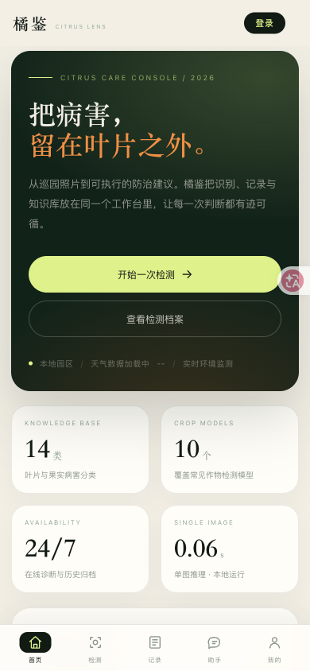
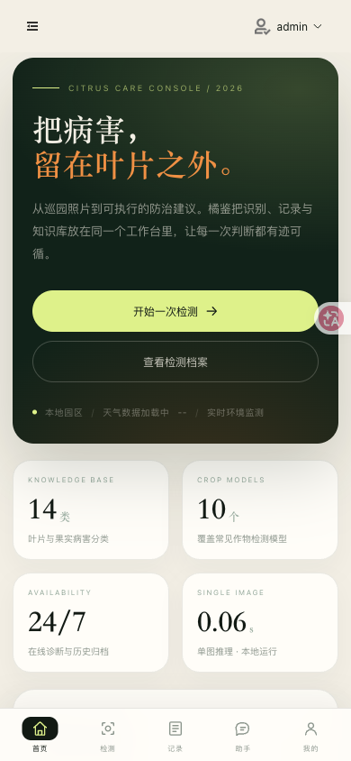

# 橘鉴 Citrus Lens

柑橘病害识别与诊断 Web 系统 + Android App。  
一个 Vue 3 前端、Spring Boot 后端、Flask + YOLO 检测服务，以及 Capacitor Android 壳。

> 仓库包含源码和可安装的 debug APK；模型权重、数据库数据、用户上传图片不包含在仓库内。

## 下载 APK

- [CitrusLens-v1.4-debug.apk](https://github.com/lixinyi061230-dotcom/citrus-lens/releases/download/v1.4/CitrusLens-v1.4-debug.apk)
- [GitHub Release v1.4](https://github.com/lixinyi061230-dotcom/citrus-lens/releases/tag/v1.4)

## 功能

- 手机端：游客先看首页，点“检测/记录/我的”再登录，登录后回到原页面
- 图片检测：上传叶片/果实照片，调用 YOLO 返回病害类别与置信度
- 检测记录：历史记录、结果图、置信度、时间
- 移动端 5 个 Tab：首页 / 检测 / 记录 / 助手 / 我的
- PWA / Android APK 安装
- 管理后台：用户管理、病害资料、视频/摄像检测等原有功能

## 仓库结构

```
web/        Vue 3 + Vite + Element Plus 前端
web/android Capacitor Android 工程
server/     Spring Boot 后端（MySQL）
detector/   Flask + Ultralytics YOLO 检测服务
docs/       安装说明、界面截图
release/    橘鉴-v1.4-debug.apk
```

## 快速启动

### 1. 数据库

创建 MySQL 数据库 `yolo_detect`，导入项目使用的表结构/初始数据。  
后端通过环境变量读取连接信息，不把密码写进仓库：

```bash
export DB_URL='jdbc:mysql://localhost:3306/yolo_detect?useUnicode=true&characterEncoding=UTF-8&serverTimezone=Asia/Shanghai&useSSL=false&allowPublicKeyRetrieval=true'
export DB_USERNAME=root
export DB_PASSWORD='你的密码'
export FILE_IP=localhost
```

### 2. Spring Boot 后端

```bash
cd server
./mvnw spring-boot:run
```

默认端口 `9999`。

### 3. Flask + YOLO 检测服务

```bash
cd detector
python3 -m venv .venv
source .venv/bin/activate
pip install -r requirements.txt
```

把模型权重放到 `detector/weights/`（仓库不包含 `.pt` 文件），然后：

```bash
python main.py
```

默认端口 `5001`。

### 4. Vue 前端

```bash
cd web
npm install
npm run dev
```

默认 `http://localhost:8888`。

### 5. Android App

```bash
cd web
cp .env.capacitor.example .env.capacitor
# 修改 .env.capacitor 里的 VITE_API_ORIGIN / VITE_FLASK_ORIGIN
npm run build:app
npx cap sync android
cd android
./gradlew assembleDebug
```

生成：

```text
web/android/app/build/outputs/apk/debug/app-debug.apk
```

当前仓库已附：

```text
release/橘鉴-v1.4-debug.apk
```

这是 debug 包，安装时允许“未知来源”；需要和运行后端的电脑在同一局域网。

## 配置与安全

- AI 助手 Key 不在仓库中，复制 `web/.env.example` 为 `web/.env.local` 后填写 `VITE_AI_API_KEY`。
- 数据库密码通过环境变量 `DB_PASSWORD` 提供。
- `spring.datasource` 默认值只用于本地开发，生产环境请显式设置。
- 不要提交 `.env`、`.env.local`、数据库备份、用户上传文件或模型权重。

## 截图





## 已知限制

- APK 是 debug 包，不是应用商店正式包。
- App 依赖局域网内的 Spring Boot / Flask / MySQL 服务，不是离线应用。
- 仓库不包含 YOLO `.pt` 权重和数据集。
- iPhone 原生 IPA 未构建，iPhone 使用 PWA“添加到主屏幕”。

## License

前端部分沿用原项目 LICENSE；其余代码仅用于学习/课程项目。
